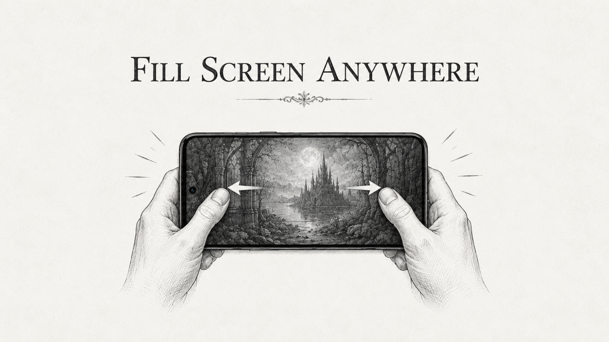
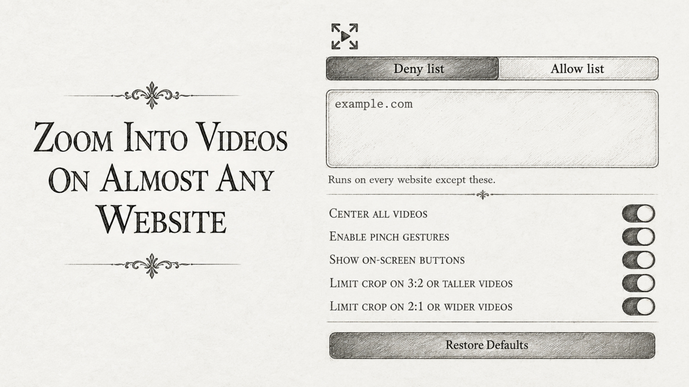
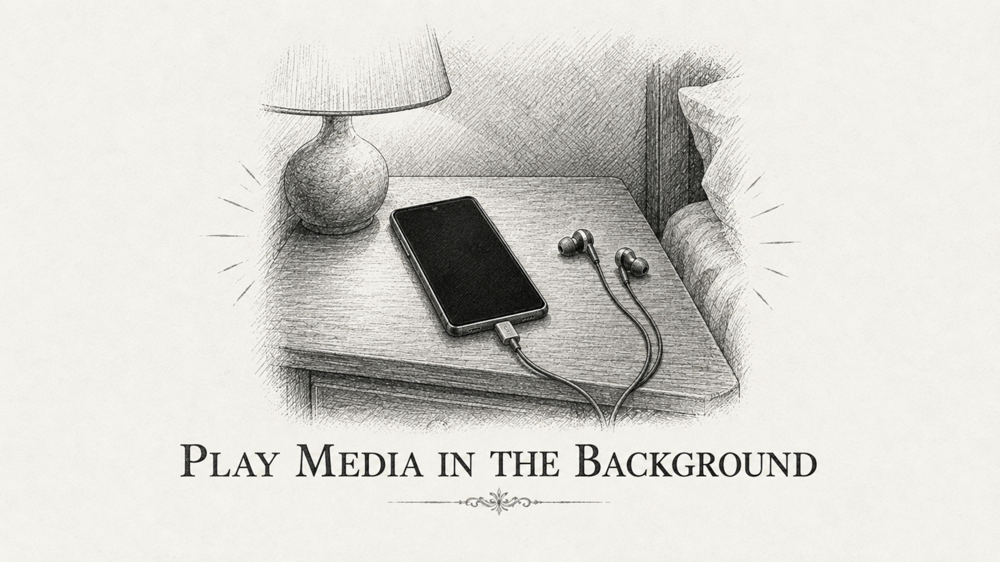
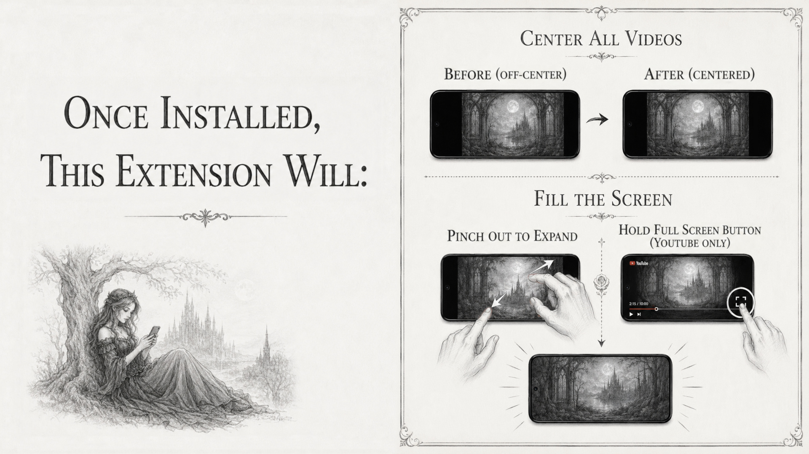
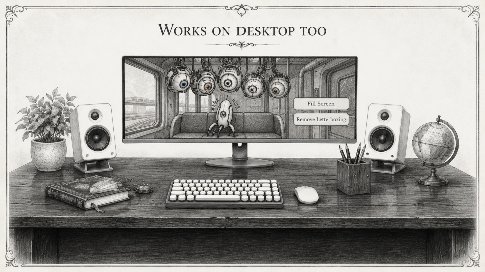

# Fill Screen Anywhere
Get it on [AMO (addons.mozilla.org)](https://addons.mozilla.org/en-US/firefox/addon/fillscreen/)

Get it on [Chrome Web Store](https://chromewebstore.google.com/detail/fill-screen-anywhere/kbfolmjecomellaiahheicnecheglbid)

---

A browser extension that allows you to zoom into videos across numerous streaming platforms.

## Browser compatibility
Works on Firefox and Chromium (see [releases](https://github.com/FaridZelli/FillScreenAnywhere/releases/latest) for XPI/CRX files).

> [!NOTE]
> On hardened browsers, enable the "Allow for all sites" permission after installation.

## Mobile usage
- Pinch in and out on your screen to toggle zoom
- Long press the full screen button to remove letterboxing (YouTube only)

## Desktop usage
- Look for the "Fill Screen" button on the right side.
### Firefox only
- Fill Screen shortcut: `Ctrl+Alt+F`
- Remove Letterboxing shortcut: `Ctrl+Alt+L`
> See [Manage extension shortcuts in Firefox](https://support.mozilla.org/en-US/kb/manage-extension-shortcuts-firefox) for more info.

## Features
- Website allow/deny list
- Center all videos (mainly for Chromium-based mobile browsers)
- Limit crop ratio for ultra-wide or standard content
- Remove 16:9 letterboxing from 21:9 content
- Play videos in the background
- And much more...

---

## Special thanks
  
[Tabler Icons](https://github.com/tabler/tabler-icons)
